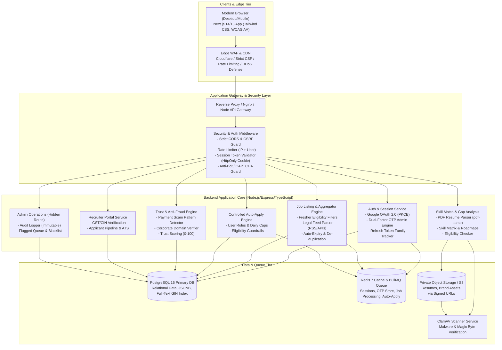
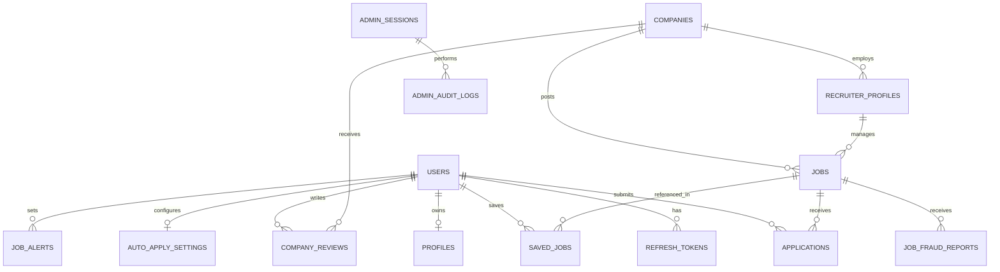

# Takshvaya (तक्ष्वया) - System Architecture & Database Design
*Production-grade, zero-ad, verified job portal for freshers (0-2 years experience)*

---

## 1. Executive Summary & Core Mission
**Takshvaya** is engineered exclusively for early-career talent and freshers (0-2 years experience). It removes exploitation in fresher hiring by enforcing:
1. **Zero Ads & Zero Scam Policy**: Completely free for candidates, no sponsored spam, zero pay-to-apply scams, automated fraud filters.
2. **Strict Verification**: Every recruiter must verify corporate email domain, GST/CIN, and phone before posting. All jobs display cryptographic/source trust badges.
3. **Dual-Factor OTP Admin Gateway**: Admin access is restricted to the strictly allowlisted identity (`bhusalapraveen6@gmail.com` / `9640742659`) requiring simultaneous Email + SMS/WhatsApp OTP verification on an unlisted administrative route.
4. **Transparent Fresher Match Engine**: Match score (%), clear eligibility criteria (Degree, Passing Year, Branch, Min CGPA/Percentage), missing skills gap analysis, and tailored learning roadmaps.
5. **Zero-Trust Security**: OWASP ASVS Level 2, rotation-based refresh token family management in HttpOnly Secure cookies, CSRF protection, strict Content-Security-Policy (CSP), and ClamAV scanned signed-URL uploads.

---

## 2. High-Level System Architecture

---

## 3. Threat Model (STRIDE Methodology)

| Threat Category | Flow / Surface | Vulnerability Vector | Mitigation in Takshvaya |
| :--- | :--- | :--- | :--- |
| **Spoofing** | User/Recruiter Login | Compromised session token or forged identity | Google OAuth 2.0 with PKCE & state/nonce checks. Server verifies Google ID token and checks email verification status. Short-lived (15 min) JWT + rotating refresh tokens. |
| **Spoofing** | Admin Portal Access | Brute-force admin login, credential stuffing | Admin credentials are never stored in DB/git. Restricted to strict allowlist (`ADMIN_EMAIL`, `ADMIN_PHONE`). OTP-only with simultaneous Email + Phone OTP (cryptographically secure 6-8 digits, 5-minute expiry, max 3 attempts). Hidden URL path. |
| **Tampering** | Resume Uploads | Malicious payload in resume (PDF/DOCX exploits, macros) | Magic byte inspection (not just MIME extension). Random UUID file naming. ClamAV anti-malware scan before S3 persistence. Metadata stripping. Served only via temporary signed URLs. |
| **Tampering** | Job Postings | Fake recruiter posting payment-scam jobs | Heuristic NLP scam filter (detects fee demands, registration charges, WhatsApp-only links, telegram invites, personal email domains). Required GST/CIN validation and corporate email domain verification. |
| **Repudiation** | Admin Actions & Moderation | Admin denies deleting a user or approving a suspicious recruiter | Append-only, immutable `audit_logs` table recording admin user ID, client IP, user agent, timestamp, action, before/after diffs. |
| **Information Disclosure** | Candidate Data (IDOR / BOLA) | Candidate A accesses Candidate B's resume or applications | Strict server-side RBAC + Object-Level Access Control (OLAC) verifying `application.user_id === req.user.id` or `job.recruiter_id === req.recruiter.id`. Zero client-side trust. |
| **Denial of Service** | Search & Auto-Apply APIs | Mass scraping, bot auto-apply spamming | Redis-backed sliding-window rate limiting per IP and per account. Per-user auto-apply volume limits (e.g., max 10/day). Cloudflare Turnstile CAPTCHA on critical endpoints. |
| **Elevation of Privilege** | Normal user calling recruiter or admin endpoints | Role parameter tampering in JWT or request body | Roles strictly retrieved from authenticated DB session/signed token. Admin routes verified against independent OTP-validated session token and IP binding. |

---

## 4. OWASP ASVS Level 2 & Security Architecture

1. **Strict Cookie Policy**:
   - `accessToken`: HttpOnly, Secure, SameSite=Strict, Max-Age=900 (15m).
   - `refreshToken`: HttpOnly, Secure, SameSite=Strict, Max-Age=604800 (7d), path-restricted to `/api/v1/auth/refresh`.
   - `adminSessionToken`: Encrypted session cookie, strictly bound to IP and User-Agent fingerprint with 30-minute idle timeout.
2. **Token Family Rotation**:
   - Every refresh generates a new refresh token and invalidates the previous one.
   - If an invalidated refresh token is presented again (indicating token theft), the entire session family is automatically revoked.
3. **Zero Ads & Privacy Assurance**:
   - No tracking pixels, Google Tag Manager, or third-party ad SDKs.
   - Self-contained analytics (anonymized hit counter).
   - Full GDPR / IT Act compliance: "Delete My Account & Data" deletes all personal records, applications, and uploaded resume files.
4. **Secure Headers**:
   - `Strict-Transport-Security: max-age=63072000; includeSubDomains; preload`
   - `Content-Security-Policy: default-src 'self'; script-src 'self'; style-src 'self' 'unsafe-inline' https://fonts.googleapis.com; font-src 'self' https://fonts.gstatic.com; img-src 'self' data: https:; connect-src 'self'; frame-ancestors 'none';`
   - `X-Content-Type-Options: nosniff`
   - `X-Frame-Options: DENY`
   - `Referrer-Policy: strict-origin-when-cross-origin`
   - `Permissions-Policy: camera=(), microphone=(), geolocation=()`

---

## 5. Relational Database Schema Design (PostgreSQL)

### Key Relational Entities:
1. **users**: Primary identity table (role: `JOB_SEEKER`, `RECRUITER`, `ADMIN`).
2. **profiles**: Candidate education (degree, branch, passing year, CGPA/percentage), parsed skills array, resume S3 key, experience months.
3. **companies**: Official name, domain, GST/CIN, logo, verification status, trust score, category ratings (work culture, fresher-friendliness, salary, growth).
4. **recruiter_profiles**: Corporate email, designation, company verification proof documents, status (`PENDING_VERIFICATION`, `VERIFIED`, `SUSPENDED`).
5. **jobs**: Fresher eligibility rules (min/max passing year, allowed degrees/branches, min CGPA), mandatory salary range, experience brackets (0, 0-1, 1-2 years), trust badge (`VERIFIED_COMPANY`, `VERIFIED_RECRUITER`, `SOURCE_VERIFIED`), fraud risk score (0-100), status (`PENDING_REVIEW`, `ACTIVE`, `EXPIRED`, `REJECTED`).
6. **applications**: Tracking statuses: `APPLIED`, `VIEWED`, `SHORTLISTED`, `INTERVIEW`, `REJECTED`, `OFFER`. Flags whether triggered via manual apply or auto-apply.
7. **auto_apply_settings**: Candidate opt-in rules (min match score e.g. 80%, allowed roles, allowed locations, min salary, max applications per day, excluded companies).
8. **job_fraud_reports**: Candidate reporting with categorized reasons (money requested, fake details, spam, WhatsApp-only link, expired).
9. **admin_otp_store**: Encrypted & salted hashes of dual OTPs for the allowlisted administrator identity, attempt counters, and expiration timers.
10. **admin_audit_logs**: Immutable write-only audit trail of every administrative mutation.
